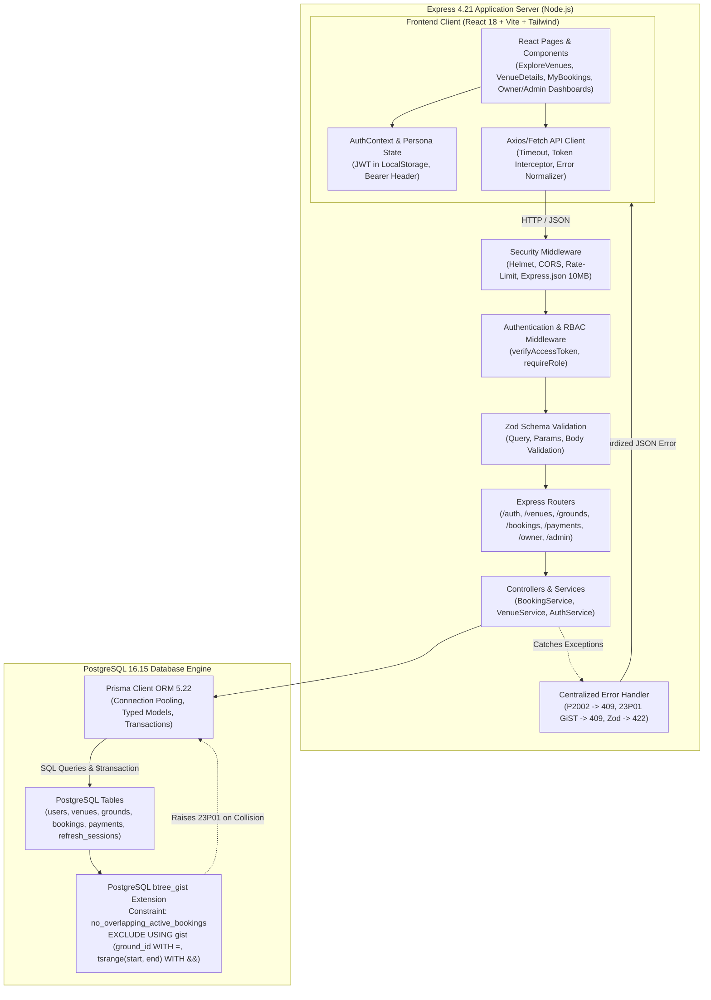

# TURFBOOK — TECHNICAL INTERVIEW MASTER PLAYBOOK & ARCHITECTURE DEFENSE GUIDE

**Project:** TurfBook — Sports Turf Booking & Multi-Tenant Management SaaS  
**Target Candidate Level:** Junior to Mid Full-Stack Software Engineer  
**Core Technologies:** React 18, TypeScript 5.7, Tailwind CSS 3.4, Node.js / Express 4.21, Prisma 5.22, PostgreSQL 16  
**Last Updated:** October 2026 (Audit & Hardening Release)

---

## TABLE OF CONTENTS
1. [Project Overview & Elevator Pitches](#1-project-overview--elevator-pitches)
2. [End-to-End Request Lifecycles & Architecture Traces](#2-end-to-end-request-lifecycles--architecture-traces)
3. [System Architecture Diagram (Mermaid)](#3-system-architecture-diagram)
4. [React 18 & TypeScript Deep Dive](#4-react-18--typescript-deep-dive)
5. [Node.js, Express & REST API Architecture](#5-nodejs-express--rest-api-architecture)
6. [PostgreSQL, Prisma & Concurrency (GiST Exclusion Constraints)](#6-postgresql-prisma--concurrency)
7. [Application Security, RBAC & Multi-Tenancy](#7-application-security-rbac--multi-tenancy)
8. [Automated Testing, QA & Concurrency Verification](#8-automated-testing-qa--concurrency-verification)
9. [DevOps, Docker & CI/CD Pipelines](#9-devops-docker--cicd-pipelines)
10. [Difficult Project-Defense Questions & Model Answers](#10-difficult-project-defense-questions--model-answers)
11. [Live Coding Interview Exercises](#11-live-coding-interview-exercises)
12. [1-Day & 7-Day Revision Plans, Glossary & Mock Interview](#12-revision-plans-glossary--mock-interview)

---

## 1. PROJECT OVERVIEW & ELEVATOR PITCHES

### 1.1 The 30-Second Elevator Pitch
> *"TurfBook is a full-stack, multi-tenant sports turf booking platform built with React, Node.js, Express, Prisma, and PostgreSQL. It solves the double-booking problem common in community sports arenas by enforcing concurrency control at the database level using PostgreSQL GiST exclusion constraints. It features dedicated portals for customers booking slots, turf owners managing multiple grounds and maintenance blocks, and platform admins reviewing venue submissions."*

### 1.2 The 90-Second Technical Pitch
> *"TurfBook is engineered to guarantee booking integrity across high-concurrency reservation scenarios. On the frontend, it uses React with TypeScript, Vite, and Tailwind CSS, featuring an availability matrix that dynamically calculates open, booked, and maintenance-blocked slots against operating hours.*  
> *The backend is an Express REST API with schema validation via Zod, JWT authentication with rotating refresh token sessions stored in PostgreSQL, and strict role-based access control across four personas.*  
> *The critical engineering highlight is our storage-level concurrency defense: rather than relying solely on fragile application-level checks, we implemented PostgreSQL's `btree_gist` extension with a multi-column exclusion constraint on `(ground_id WITH =, tsrange(start_time, end_time, '[)') WITH &&)`. When concurrent requests race for the same slot, PostgreSQL raises error code `23P01`, which our centralized error handler translates into a clean HTTP 409 Conflict. The entire suite is verified through automated integration tests."*

### 1.3 The 3-Minute Comprehensive Architecture Pitch
*(Use when the interviewer says: "Walk me through the design of your flagship project.")*
1. **The Business Problem:** Sports turfs in urban areas suffer from lost revenue and customer frustration due to manual phone reservations, conflicting bookings, and uncoordinated maintenance blocks. TurfBook centralizes discovery, real-time availability, and reservations.
2. **User Personas & Multi-Tenancy:**
   - **Anonymous Visitor:** Can browse approved venues, view sports categories, inspect grounds, and see available slots.
   - **Customer:** Authenticates, books available slots with authoritative server-side price calculation, views personal booking history, cancels eligible bookings (>2h notice), and leaves verified reviews.
   - **Turf Owner:** Manages only their registered venues and grounds, defines operating hours, schedules maintenance blocks, and inspects venue-specific revenue and bookings.
   - **Platform Admin:** Verifies and approves pending venue submissions, activates/deactivates user accounts, and monitors platform-wide audit logs.
3. **Data Flow & Transaction Boundaries:**
   - Client sends slot reservation request -> Express passes through `authenticate` middleware -> Zod validates request body -> Controller invokes `BookingService` -> A Prisma `$transaction` executes at `Serializable` isolation level -> GiST exclusion constraint guarantees no temporal overlap on the ground -> Payment and notifications records are generated -> Response returns HTTP 201 Created.
4. **Tested vs. Unverified:**
   - Tested: 23 automated integration tests verifying pricing calculations, authentication, concurrent race collisions against real PostgreSQL, slot cancellation availability releases, and cross-owner IDOR rejections.
   - Unverified / Simulated: Real banking payment gateways (simulated in development) and production cloud infrastructure.

---

## 2. END-TO-END REQUEST LIFECYCLES & ARCHITECTURE TRACES

### Lifecycle 1: Customer Login & Token Issuance
- **Frontend Trigger:** User submits form in [`client/src/pages/Login.tsx`](file:///c:/Users/mange/OneDrive/Desktop/turfbook/client/src/pages/Login.tsx).
- **API Client:** Calls `api.post('/auth/login', { email, password })` in [`client/src/services/api.ts`](file:///c:/Users/mange/OneDrive/Desktop/turfbook/client/src/services/api.ts).
- **HTTP Endpoint:** `POST /api/v1/auth/login`.
- **Middleware:** `authLimiter` (rate-limits to 30 requests per 15 minutes) -> `validateRequest({ body: loginSchema })` in [`server/src/modules/auth/auth.routes.ts`](file:///c:/Users/mange/OneDrive/Desktop/turfbook/server/src/modules/auth/auth.routes.ts#L29-L31).
- **Controller:** `authController.login` in [`server/src/modules/auth/auth.controller.ts`](file:///c:/Users/mange/OneDrive/Desktop/turfbook/server/src/modules/auth/auth.controller.ts).
- **Service:** `authService.login` in [`server/src/modules/auth/auth.service.ts`](file:///c:/Users/mange/OneDrive/Desktop/turfbook/server/src/modules/auth/auth.service.ts#L89-L138).
- **Database Operations:**
  1. `prisma.user.findUnique({ where: { email } })` retrieves user and `passwordHash`.
  2. `comparePassword(password, user.passwordHash)` compares using `bcryptjs`.
  3. `generateAccessToken` signs a 15-minute JWT.
  4. `generateRefreshToken` signs a 7-day JWT with random `jti`.
  5. `prisma.refreshSession.create` stores SHA-256 hashed refresh token in table `refresh_sessions`.
- **Response & UI Update:** Server responds with HTTP 200 `{ accessToken, refreshToken, user }`. Frontend stores tokens in `localStorage`, updates `AuthContext` state, and navigates user to dashboard.

---

### Lifecycle 2: Public Venue Discovery & Search
- **Frontend Component:** [`client/src/pages/ExploreVenues.tsx`](file:///c:/Users/mange/OneDrive/Desktop/turfbook/client/src/pages/ExploreVenues.tsx).
- **API Client:** Calls `venueApi.list({ search, city, sport, page, limit })`.
- **HTTP Endpoint:** `GET /api/v1/venues?search=...&city=...`.
- **Middleware:** `validateRequest({ query: listVenuesQuerySchema })`.
- **Controller:** `venueController.listVenues` in [`server/src/modules/venues/venue.controller.ts`](file:///c:/Users/mange/OneDrive/Desktop/turfbook/server/src/modules/venues/venue.controller.ts#L8-L30).
- **Service:** `venueService.listVenues` in [`server/src/modules/venues/venue.service.ts`](file:///c:/Users/mange/OneDrive/Desktop/turfbook/server/src/modules/venues/venue.service.ts#L30-L150).
- **Database Query:**
  - `prisma.venue.findMany` with `where: { status: 'APPROVED', city: ..., grounds: { some: { sportId } } }`.
  - Includes related active `grounds`, `reviews` for average rating, and `venueSports`.
- **Response & UI Update:** Returns paginated list of venues. React renders items using [`client/src/components/VenueCard.tsx`](file:///c:/Users/mange/OneDrive/Desktop/turfbook/client/src/components/VenueCard.tsx) with starting hourly rates and sport icons.

---

### Lifecycle 3: Slot Availability Calculation
- **Frontend Component:** Date picker and slot grid in [`client/src/pages/VenueDetails.tsx`](file:///c:/Users/mange/OneDrive/Desktop/turfbook/client/src/pages/VenueDetails.tsx).
- **API Client:** Calls `availabilityApi.get(groundId, selectedDate)`.
- **HTTP Endpoint:** `GET /api/v1/grounds/:id/availability?date=YYYY-MM-DD`.
- **Controller:** `availabilityController.getAvailability` in [`server/src/modules/availability/availability.controller.ts`](file:///c:/Users/mange/OneDrive/Desktop/turfbook/server/src/modules/availability/availability.controller.ts#L7-L20).
- **Service Logic:** `availabilityService.getGroundAvailability` in [`server/src/modules/availability/availability.service.ts`](file:///c:/Users/mange/OneDrive/Desktop/turfbook/server/src/modules/availability/availability.service.ts#L10-L165).
- **Calculation Mechanism:**
  1. Finds ground operating hours for the specific day of week (`dayOfWeek = start.getUTCDay()`).
  2. Queries existing bookings for that day where `status IN ('CONFIRMED', 'PENDING_PAYMENT')`.
  3. Queries active `blockedPeriods` on that ground.
  4. Loops hour-by-hour from `openTime` to `closeTime`.
  5. Evaluates status priority: if past current time -> `'PAST'`; if overlaps active booking -> `'BOOKED'`; if overlaps maintenance block -> `'BLOCKED'`; otherwise -> `'AVAILABLE'`.
- **UI Update:** Renders clickable green badges for available slots and disabled badges for booked/blocked slots.

---

### Lifecycle 4: Concurrency-Protected Booking Creation
- **Frontend Component:** "Confirm & Pay" in [`client/src/pages/VenueDetails.tsx`](file:///c:/Users/mange/OneDrive/Desktop/turfbook/client/src/pages/VenueDetails.tsx).
- **HTTP Endpoint:** `POST /api/v1/bookings`.
- **Middleware:** `authenticate` (validates Bearer JWT) -> `validateRequest({ body: createBookingSchema })`.
- **Controller:** `bookingController.createBooking` in [`server/src/modules/bookings/booking.controller.ts`](file:///c:/Users/mange/OneDrive/Desktop/turfbook/server/src/modules/bookings/booking.controller.ts#L7-L32).
- **Service Logic:** `bookingService.createBooking` in [`server/src/modules/bookings/booking.service.ts`](file:///c:/Users/mange/OneDrive/Desktop/turfbook/server/src/modules/bookings/booking.service.ts#L27-L228).
- **Validation & Business Rules:**
  1. `end > start` and `start > now - 60s` (rejects past slots).
  2. Verifies ground is active and venue is `APPROVED`.
  3. Checks requested interval is within venue opening hours.
  4. Authoritatively calculates subtotal, tax (18% GST), and total price on the server via `calculateBookingPrice`.
- **Storage Transaction (`Serializable`):**
  ```typescript
  await prisma.$transaction(async (tx) => {
    // 1. App-level conflict pre-check
    // 2. tx.booking.create(...)
    // 3. tx.payment.create(...)
    // 4. tx.notification.create(...)
  }, { isolationLevel: Prisma.TransactionIsolationLevel.Serializable });
  ```
- **PostgreSQL Constraint Enforcement:** PostgreSQL verifies constraint `no_overlapping_active_bookings`. If another transaction already committed an overlapping slot, PostgreSQL aborts with `23P01`, caught by catch block and thrown as `ConflictError`.
- **UI Update:** Client navigates to [`client/src/pages/BookingConfirmation.tsx`](file:///c:/Users/mange/OneDrive/Desktop/turfbook/client/src/pages/BookingConfirmation.tsx) displaying the unique booking number (e.g. `TB-261024-X8J2`).

---

### Lifecycle 5: Booking Cancellation & Availability Restoration
- **Frontend Component:** Cancellation modal in [`client/src/pages/MyBookings.tsx`](file:///c:/Users/mange/OneDrive/Desktop/turfbook/client/src/pages/MyBookings.tsx).
- **HTTP Endpoint:** `POST /api/v1/bookings/:id/cancel` with `{ reason: string }`.
- **Service Logic:** `bookingService.cancelBooking` in [`server/src/modules/bookings/booking.service.ts`](file:///c:/Users/mange/OneDrive/Desktop/turfbook/server/src/modules/bookings/booking.service.ts#L303-L381).
- **Rules Enforced:**
  1. Ownership: `booking.customerId === req.user.userId` or `booking.ground.venue.ownerId === req.user.userId` or `ADMIN`.
  2. Status: cannot cancel if already `CANCELLED` (rejects with 400) or `COMPLETED`.
  3. Time constraint: customer must cancel at least 2 hours before scheduled `startTime`.
- **Database Transaction:**
  1. Updates `booking.status` to `'CANCELLED'`.
  2. Sets `cancelledAt = now()` and records `cancellationReason`.
  3. Updates associated payment status to `REFUNDED`.
  4. Generates customer cancellation notification.
- **GiST Lock Release:** Because the exclusion constraint has `WHERE (status IN ('CONFIRMED', 'PENDING_PAYMENT'))`, changing the status to `'CANCELLED'` immediately releases the exclusion lock, allowing other users to reserve that slot instantly.

---

### Lifecycle 6: Owner Venue & Ground Management (Tenant-Scoped)
- **Frontend Page:** [`client/src/pages/owner/OwnerVenues.tsx`](file:///c:/Users/mange/OneDrive/Desktop/turfbook/client/src/pages/owner/OwnerVenues.tsx) and [`client/src/pages/owner/OwnerGrounds.tsx`](file:///c:/Users/mange/OneDrive/Desktop/turfbook/client/src/pages/owner/OwnerGrounds.tsx).
- **Endpoints:** `PATCH /api/v1/venues/:id`, `POST /api/v1/venues/:venueId/grounds`, `PATCH /api/v1/grounds/:id`.
- **Authorization Check:**
  - Route middleware: `authorize(Role.OWNER, Role.ADMIN)`.
  - Service-level tenant check:
    ```typescript
    if (userRole !== Role.ADMIN && venue.ownerId !== userId) {
      throw new ForbiddenError('You can only update venues that you own');
    }
    ```
- **IDOR Protection:** Even if Owner A guesses Owner B's UUID, the database check rejects the action with HTTP 403 Forbidden.

---

### Lifecycle 7: Admin Venue Approval Workflow
- **Frontend Page:** [`client/src/pages/admin/AdminVenuesQueue.tsx`](file:///c:/Users/mange/OneDrive/Desktop/turfbook/client/src/pages/admin/AdminVenuesQueue.tsx).
- **HTTP Endpoint:** `POST /api/v1/admin/venues/:id/approve`.
- **Middleware:** `authenticate` -> `authorize(Role.ADMIN)`.
- **Controller:** `adminController.approveVenue` in [`server/src/modules/admin/admin.controller.ts`](file:///c:/Users/mange/OneDrive/Desktop/turfbook/server/src/modules/admin/admin.controller.ts#L37-L72).
- **Database Update:** Updates `venue.status` from `PENDING` to `APPROVED`, sends approval notification to venue owner, and records audit log in `audit_logs` table.

---

## 3. SYSTEM ARCHITECTURE DIAGRAM



---

## 4. REACT 18 & TYPESCRIPT DEEP DIVE

### 4.1 State Management & Context API
TurfBook uses React's native `Context` API (`AuthContext`) rather than Redux or Zustand.
- **Why?** TurfBook's global state requirements are straightforward: authenticated user profile, active JWT token, and session loading state. Localizing component state (dates, slot selections, filters) in pages keeps memory overhead low and prevents unnecessary re-renders across unaffected routes.
- **Token Persistence:** The `accessToken` and user object are stored in `localStorage`. On application mount, `useEffect` initializes the state and verifies token validity against `/api/v1/auth/me`.

### 4.2 Handling Async Lifecycle & Race Conditions in React
In [`client/src/pages/VenueDetails.tsx`](file:///c:/Users/mange/OneDrive/Desktop/turfbook/client/src/pages/VenueDetails.tsx), when a customer quickly clicks between different dates or grounds, multiple availability API requests can fire in rapid succession.
- **The Bug:** If request for Date 1 resolves *after* request for Date 2, the UI displays stale Date 1 slots while Date 2 is selected.
- **The Solution:** Use an `active` boolean cleanup flag or `AbortController`:
  ```typescript
  useEffect(() => {
    let isCurrent = true;
    setLoading(true);
    availabilityApi.get(groundId, selectedDate)
      .then(res => {
        if (isCurrent) setAvailability(res.data);
      })
      .catch(err => {
        if (isCurrent) setError(err.message);
      })
      .finally(() => {
        if (isCurrent) setLoading(false);
      });
    return () => { isCurrent = false; };
  }, [groundId, selectedDate]);
  ```

### 4.3 Component Reusability & Resilient UI Components
- **`ImageWithFallback.tsx`:** Sports venue images from Unsplash or external CDNs often return 404 or fail on slow connections. Our component renders a shimmer skeleton during load and transitions to an embedded SVG placeholder if the image errors, preventing broken image icons.
- **`VenueCard.tsx`:** Used uniformly in the landing page, explore directory, and search results to ensure consistent card heights, price formatting (`₹/hour`), sport tags, and accessible ARIA attributes.

---

## 5. NODE.JS, EXPRESS & REST API ARCHITECTURE

### 5.1 The Node.js Event Loop & Non-Blocking I/O
- Node.js operates on a single-threaded event loop powered by `libuv`.
- **Interview Answer:** *"While JavaScript execution is single-threaded, database queries and network calls are offloaded to OS kernel threads or the libuv thread pool. In TurfBook, asynchronous functions (`async/await`) yield execution back to the event loop while waiting for PostgreSQL queries to resolve, allowing the server to handle hundreds of concurrent requests without thread starvation."*

### 5.2 Middleware Pipeline Order
The order of Express middleware in [`server/src/app.ts`](file:///c:/Users/mange/OneDrive/Desktop/turfbook/server/src/app.ts) is strictly sequenced:
1. `helmet()` — security HTTP response headers.
2. `cors()` — origin whitelisting (`localhost:5173`, `localhost:3000`).
3. `cookieParser()` — cookie extraction.
4. `express.json({ limit: '10mb' })` — body parser with 10MB payload cap to prevent memory exhaustion DoS.
5. `/health` & `/api-docs` — unauthenticated health check and Swagger UI.
6. `/api/v1` routers with route-specific authentication (`authenticate`) and role checks (`authorize`).
7. 404 handler for unmatched routes (`NotFoundError`).
8. `errorHandler` — 4-parameter centralized error handler `(err, req, res, next)`.

### 5.3 Error Handling Architecture
Express does not catch errors thrown inside asynchronous promises unless they are passed to `next(err)`.
All TurfBook controllers wrap async service invocations in `try/catch` and forward errors to `next(err)`.
The centralized error handler in [`server/src/middleware/errorHandler.ts`](file:///c:/Users/mange/OneDrive/Desktop/turfbook/server/src/middleware/errorHandler.ts) standardizes output:
```json
{
  "success": false,
  "error": {
    "code": "BOOKING_SLOT_CONFLICT",
    "message": "This ground has already been booked or blocked for the requested time range."
  }
}
```
In production (`NODE_ENV === 'production'`), internal stack traces are redacted to prevent information disclosure.

---

## 6. POSTGRESQL, PRISMA & CONCURRENCY

### 6.1 Why PostgreSQL Over MongoDB for a Booking System?
- **ACID Transactions:** Relational consistency guarantees that reservations, payment records, and slot locks are committed atomically.
- **GiST Exclusion Constraints:** MongoDB supports unique single-field or compound indexes (e.g. `{ groundId: 1, startTime: 1 }`), but **cannot** index continuous temporal intervals to prevent range overlap (`start_time < slot_end AND end_time > slot_start`). PostgreSQL's `btree_gist` extension allows indexing continuous ranges (`tsrange`) with an overlap operator (`&&`).

### 6.2 The Exclusion Constraint Explained
From migration [`20261023235033_add_gist_exclusion_constraint/migration.sql`](file:///c:/Users/mange/OneDrive/Desktop/turfbook/server/prisma/migrations/20261023235033_add_gist_exclusion_constraint/migration.sql):
```sql
CREATE EXTENSION IF NOT EXISTS btree_gist;

ALTER TABLE "bookings"
ADD CONSTRAINT "no_overlapping_active_bookings"
EXCLUDE USING gist (
  ground_id WITH =,
  tsrange(start_time, end_time, '[)') WITH &&
)
WHERE (status IN ('CONFIRMED', 'PENDING_PAYMENT'));
```
- `btree_gist`: Enables GiST indexing for scalar types (like UUID `ground_id`).
- `ground_id WITH =`: Ensures the constraint only evaluates slots belonging to the same ground.
- `tsrange(start_time, end_time, '[)') WITH &&`: Creates a half-open interval `[start, end)`. The operator `&&` asserts that no two intervals on the same ground can overlap.
- `WHERE (status IN ('CONFIRMED', 'PENDING_PAYMENT'))`: Partial index filter! Cancelled or completed bookings do not block new reservations.

### 6.3 Walking Through the Race Condition Step-by-Step
**Scenario:** Customer 1 and Customer 2 click "Book" at the exact same millisecond for Friday 18:00 - 19:00 on Ground A.
1. Request 1 and Request 2 arrive at Express.
2. Both pass input validation and enter `bookingService.createBooking`.
3. Both begin Prisma transactions.
4. Request 1 executes `INSERT INTO bookings ...`. PostgreSQL checks the GiST tree on `bookings`. No active range conflicts exist. Row is inserted.
5. Request 2 executes `INSERT INTO bookings ...`. PostgreSQL checks the GiST tree. It detects an active conflicting `tsrange` on `ground_id`.
6. PostgreSQL raises internal error code **`23P01` (`exclusion_violation`)** and immediately rolls back Transaction 2.
7. Request 1 transaction commits successfully -> returns HTTP 201 Created.
8. Request 2 catches `23P01` -> returns HTTP 409 Conflict.
9. Database state: Exactly **one** booking exists. Zero data corruption.

---

## 7. APPLICATION SECURITY, RBAC & MULTI-TENANCY

### 7.1 Authentication vs. Authorization
- **Authentication (AuthN):** "Who are you?" Verified via email/password during login and validated on subsequent requests via JWT signature verification (`authenticate` middleware).
- **Authorization (AuthZ):** "What are you allowed to do?" Enforced via roles (`authorize(Role.OWNER, Role.ADMIN)`) and resource ownership checks.

### 7.2 Insecure Direct Object Reference (IDOR) Hardening
- **Definition:** An access control flaw where an application uses user-supplied input to access objects directly without verifying ownership.
- **Audited Vulnerability in TurfBook:** In `simulatePaymentResult`, a caller could submit `POST /api/v1/payments/:id/simulate-result` with any payment UUID.
- **Fix Applied:**
  ```typescript
  if (userRole !== Role.ADMIN && payment.booking.customerId !== userId) {
    throw new ForbiddenError('You can only simulate payment for your own bookings');
  }
  ```
- **Owner Boundary Enforcement:**
  When Owner A updates Ground B (`PATCH /api/v1/grounds/:id`), `ground.service.ts` joins the venue and asserts `ground.venue.ownerId === userId`. If not, it throws `ForbiddenError` (403).

### 7.3 Refresh Token Rotation & Session Management
- Refresh tokens are long-lived (7 days). If a refresh token is stolen, an attacker could maintain persistent access.
- TurfBook implements **Refresh Token Rotation**:
  1. The client sends the refresh token to `POST /api/v1/auth/refresh`.
  2. The server hashes the incoming token with SHA-256 and searches `refresh_sessions`.
  3. If the token is already revoked or expired, access is denied.
  4. The server marks the existing session `isRevoked: true` and issues a brand-new token pair.
  5. If an attacker attempts to replay a previously rotated token, the system detects reuse and rejects the request.

---

## 8. AUTOMATED TESTING, QA & CONCURRENCY VERIFICATION

### 8.1 The Test Pyramid in TurfBook
1. **Unit Tests (`server/tests/pricing.test.ts`):** Fast tests with zero network or database dependencies. Tests business logic like slot duration math, GST tax calculation (18%), and subtotal calculation across boundary durations (60m, 90m, 180m).
2. **Integration Tests (`server/tests/auth.test.ts` & `security-rbac.test.ts`):** Tests Express HTTP routes against a real PostgreSQL database. Validates HTTP status codes (200, 201, 401, 403, 422), password hashing, JWT extraction, and cross-owner IDOR blocks.
3. **Concurrency Race Tests (`server/tests/booking-concurrency.test.ts`):** Fires simultaneous asynchronous requests using `Promise.all` against the real PostgreSQL GiST constraint. Asserts that exactly one request receives 201 and the other receives 409, and queries the database directly to confirm count = 1.

### 8.2 Why a Passing Build != A Working Application
- `tsc` (TypeScript compiler) only validates type safety at compile time; it cannot verify database foreign key constraints, network timeouts, or runtime business invariants.
- Running end-to-end integration tests against real PostgreSQL is essential for proving concurrency safety and referential integrity.

---

## 9. DEVOPS, DOCKER & CI/CD PIPELINES

### 9.1 Multi-Stage Dockerfiles
- **Client (`client/Dockerfile`):**
  - Stage 1 (Builder): Node.js alpine image installs dependencies and runs `npm run build` (Vite compiles static assets into `dist/`).
  - Stage 2 (Runner): Lightweight Nginx alpine image copies only `dist/` and serves static files. Results in an image size of under 25MB with zero Node.js runtime attack surface.
- **Server (`server/Dockerfile`):**
  - Stage 1 (Builder): Compiles TypeScript code to `dist/` and generates Prisma Client.
  - Stage 2 (Runner): Copies only compiled JS and production dependencies (`npm ci --only=production`), running `npx prisma migrate deploy && node dist/server.js`.

### 9.2 GitHub Actions CI Pipeline
Our CI workflow in [`.github/workflows/ci.yml`](file:///c:/Users/mange/OneDrive/Desktop/turfbook/.github/workflows/ci.yml):
1. Spins up an ephemeral `postgres:16-alpine` service container with a healthcheck.
2. Runs `npx prisma migrate deploy` to test migration execution on a clean database.
3. Runs `npx tsx prisma/seed.ts` to populate test fixtures.
4. Executes `npm test` (all 23 Vitest tests).
5. Runs production bundle builds for both client and server.

---

## 10. DIFFICULT PROJECT-DEFENSE QUESTIONS & MODEL ANSWERS

#### Q1: "Why didn't you use Redis for distributed locking instead of PostgreSQL GiST constraints?"
> **Answer:** *"Redis Redlock is a popular pattern for distributed locking, but it introduces an extra stateful infrastructure dependency and network hop. More importantly, Redis locks exist outside the database transaction boundary. If the application server crashes or experiences a network partition between acquiring the Redis lock and committing to PostgreSQL, the lock could expire prematurely or leave orphan state. By using PostgreSQL's GiST exclusion constraint, the lock is enforced atomically by the database storage engine inside the same transaction that writes the booking record. For TurfBook's scale, PostgreSQL provides absolute correctness with zero operational overhead."*

#### Q2: "What happens if a user submits two booking requests concurrently for different grounds?"
> **Answer:** *"Both requests will succeed without conflict because the exclusion constraint is partitioned by `ground_id`. The GiST index checks `(ground_id WITH =, tsrange(start_time, end_time, '[)') WITH &&)`. Since the `ground_id` values differ, the exclusion condition is satisfied for both."*

#### Q3: "How does your system prevent a customer from tampering with the booking price in the browser?"
> **Answer:** *"The client never sends a price to the server. The request body only contains `groundId`, `startTime`, and `endTime`. When the request arrives at `bookingService.createBooking`, the server looks up the authoritative `hourlyRate` from the database and calculates the duration, subtotal, and tax using the server-side utility `calculateBookingPrice()`. Client-side prices are treated purely as display projections."*

#### Q4: "What happens when a customer cancels a booking twice in rapid succession?"
> **Answer:** *"The first request enters a transaction, verifies `booking.status === 'CONFIRMED'`, and updates it to `'CANCELLED'`. The second request finds `booking.status === 'CANCELLED'` and immediately throws a `BadRequestError('Booking is already cancelled')`, returning an HTTP 400. This is idempotent and prevents duplicate refund processing."*

#### Q5: "How do you handle timezones across venues in different cities?"
> **Answer:** *"All timestamps are stored in PostgreSQL as `TIMESTAMPTZ` (UTC). When availability is calculated, slot generation uses UTC hours and compares against venue operating hours. On the frontend, dates and times are displayed formatted according to the user's local timezone or the venue's configured operating hours."*

#### Q6: "What is the single weakest part of your current implementation, and what would you fix next?"
> **Answer:** *"The payment integration is currently simulated. While the state machine (`PENDING` -> `SUCCESS` / `FAILED` -> `REFUNDED`) is modeled in PostgreSQL and verified with IDOR protection, a commercial deployment requires integrating real payment webhooks (e.g. Razorpay or Stripe) with HMAC cryptographic signature validation, idempotency replay headers, and an asynchronous reconciliation worker for orphaned pending payments."*

---

## 11. LIVE CODING INTERVIEW EXERCISES

### Exercise 1: Validate a Booking Time Range
**Problem:** Write a TypeScript function that validates whether a requested start and end time string are valid for a 60-minute to 180-minute slot and is scheduled in the future.
```typescript
export function validateBookingRange(startTime: string, endTime: string): { valid: boolean; error?: string } {
  const start = new Date(startTime);
  const end = new Date(endTime);
  const now = new Date();

  if (isNaN(start.getTime()) || isNaN(end.getTime())) {
    return { valid: false, error: 'Invalid ISO date string format' };
  }
  if (start.getTime() < now.getTime() - 60000) {
    return { valid: false, error: 'Cannot book slots in the past' };
  }
  if (end <= start) {
    return { valid: false, error: 'End time must be after start time' };
  }
  const durationMinutes = (end.getTime() - start.getTime()) / (1000 * 60);
  if (durationMinutes < 60 || durationMinutes > 180) {
    return { valid: false, error: 'Booking duration must be between 60 and 180 minutes' };
  }
  return { valid: true };
}
```

### Exercise 2: Express Ownership Verification Middleware
**Problem:** Write an Express middleware factory `requireVenueOwnership` that verifies the authenticated user owns the venue identified by `req.params.venueId`.
```typescript
import { Request, Response, NextFunction } from 'express';
import { prisma } from '../config/prisma.js';
import { ForbiddenError, NotFoundError } from '../common/errors/AppError.js';
import { Role } from '@prisma/client';

export function requireVenueOwnership() {
  return async (req: any, _res: Response, next: NextFunction) => {
    try {
      const venueId = req.params.venueId || req.params.id;
      if (req.user.role === Role.ADMIN) return next();

      const venue = await prisma.venue.findUnique({
        where: { id: venueId },
        select: { ownerId: true },
      });
      if (!venue) throw new NotFoundError('Venue not found');
      if (venue.ownerId !== req.user.userId) {
        throw new ForbiddenError('You do not have permission to manage this venue');
      }
      next();
    } catch (err) {
      next(err);
    }
  };
}
```

---

emove ewove 